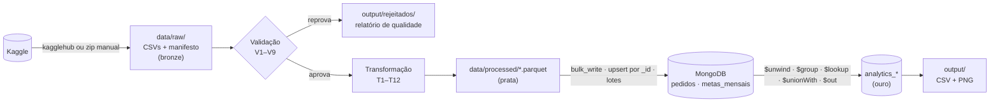
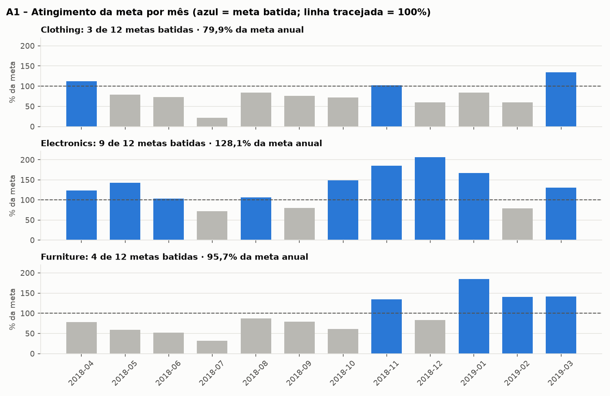
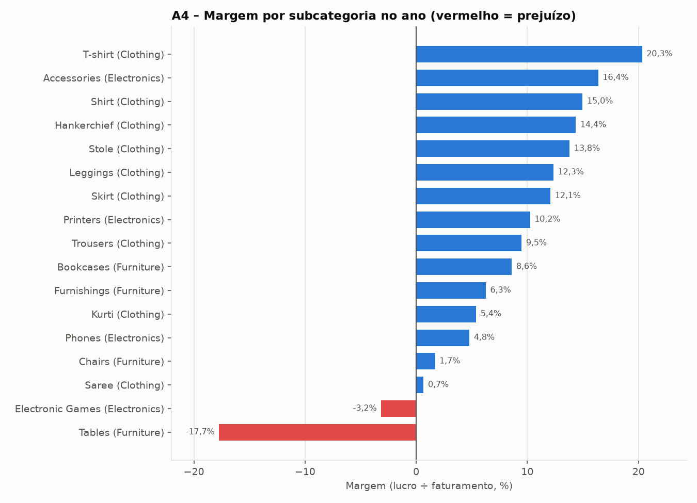

# Pipeline E-Commerce Data → MongoDB (Avaliação N3)

Implementação do pipeline de ingestão especificado na N2 da disciplina Desenvolvimento com Linguagens Disruptivas I (ADS, UniCESUSC), Equipe10. Autor: Lorenzo Osório Gonçalves da Silveira.

## Objetivo e cenário

Na N2 defini o cenário a partir do varejo em que trabalho (ótica): o **gerente comercial fecha o mês por praça**. Na reunião ele precisa saber se cada categoria bateu a meta, quais praças (cidade + estado) puxam ou seguram o resultado, quanto do movimento sai com um item só (venda casada) e onde a venda dá prejuízo.

O pipeline leva os 3 CSVs do dataset [E-Commerce Data](https://www.kaggle.com/datasets/benroshan/ecommerce-data) (Kaggle, licença CC0) até o MongoDB como **agregados de pedido**, e responde as 4 análises com aggregation pipelines dentro do banco.

## Pipeline



| Etapa | Código | O que faz |
|---|---|---|
| extract | `src/pipeline/extract.py` | kagglehub com fallback para `data/raw/`; manifesto com SHA-256, bytes e linhas |
| validate | `src/pipeline/validate.py` | regras V1–V9; rejeitados em `output/rejeitados/`, relatório em `output/relatorio_qualidade.md` |
| transform | `src/pipeline/transform.py` | regras T1–T12 (datas, cidade × estado, flags de outlier/prejuízo, HMAC do cliente…); Parquet |
| load | `src/pipeline/load.py` | validador `$jsonSchema`, upsert idempotente em lotes, índices, conciliação |
| analyze | `src/pipeline/analyses/a1…a4` | aggregations A1–A4 → coleções `analytics_*` + CSV e gráficos |

Cada regra da N2 aponta para a função que a implementa em [`docs/RASTREABILIDADE.md`](docs/RASTREABILIDADE.md).

## Modelo de agregados

- `pedidos` (500): um documento por pedido, `_id` = Order ID, com `itens[]`, `praca`, `totais` e `_carga` embutidos.
- `metas_mensais` (36): `_id` = `AAAA-MM#Categoria`.
- `analytics_meta_realizado`, `analytics_pracas`, `analytics_venda_casada` e `analytics_margem_subcategoria`: camada ouro, recriadas por `$out`.

Documento real do banco (pedido B-25608, Chennai: 3 categorias, um item com prejuízo maior que a venda). Os campos aparecem em ordem alfabética porque o upsert cria o documento via `$set`; ver [desvios](docs/N3/desvios_da_N2.md).

```json
{
  "_id": "B-25608",
  "_carga": { "sha256_origem": "e08da8cddf08", "versao_pipeline": "1.0" },
  "cliente_ref": "96d01906f8838f01",
  "competencia": "2018-04",
  "data_pedido": { "$date": "2018-04-08T00:00:00Z" },
  "itens": [
    { "posicao": 1, "categoria": "Furniture", "subcategoria": "Tables", "quantidade": 5,
      "valor": { "$numberDecimal": "1364.00" }, "lucro": { "$numberDecimal": "-1864.00" },
      "preco_unitario": { "$numberDecimal": "272.80" },
      "flags": { "prejuizo": true, "valor_atipico": true, "prejuizo_maior_que_venda": true } },
    { "posicao": 2, "categoria": "Furniture", "subcategoria": "Chairs", "quantidade": 3,
      "valor": { "$numberDecimal": "476.00" }, "lucro": { "$numberDecimal": "0.00" },
      "preco_unitario": { "$numberDecimal": "158.67" },
      "flags": { "prejuizo": false, "valor_atipico": false, "prejuizo_maior_que_venda": false } },
    { "posicao": 3, "categoria": "Clothing", "subcategoria": "Hankerchief", "quantidade": 5,
      "valor": { "$numberDecimal": "257.00" }, "lucro": { "$numberDecimal": "23.00" },
      "preco_unitario": { "$numberDecimal": "51.40" },
      "flags": { "prejuizo": false, "valor_atipico": false, "prejuizo_maior_que_venda": false } },
    { "posicao": 4, "categoria": "Electronics", "subcategoria": "Printers", "quantidade": 6,
      "valor": { "$numberDecimal": "856.00" }, "lucro": { "$numberDecimal": "385.00" },
      "preco_unitario": { "$numberDecimal": "142.67" },
      "flags": { "prejuizo": false, "valor_atipico": true, "prejuizo_maior_que_venda": false } }
  ],
  "mes_fiscal": 1,
  "praca": { "cidade": "Chennai", "estado": "Tamil Nadu" },
  "totais": { "valor": { "$numberDecimal": "2953.00" }, "lucro": { "$numberDecimal": "-1456.00" },
              "margem_pct": -49.31, "qtd_itens": 4, "qtd_unidades": 19,
              "categorias": ["Clothing", "Electronics", "Furniture"], "item_unico": false }
}
```

O `cliente_ref` depende da chave `HMAC_KEY` do seu `.env`, então o seu valor vai ser diferente.

## Pré-requisitos

- Python 3.11 ou mais novo (testado com 3.13)
- Docker Desktop (para o MongoDB 7 e o mongo-express). Sem Docker, veja [Rodar sem Docker](#rodar-sem-docker).
- Git

## Passo a passo do zero

```bash
git clone <url-deste-repositório> pipeline-ecommerce
cd pipeline-ecommerce
cp .env.example .env                     # Windows: copy .env.example .env  →  troque o HMAC_KEY
docker compose up -d                     # MongoDB 7 em localhost:27017 + mongo-express em :8081
python -m venv .venv
source .venv/bin/activate                # Windows: .venv\Scripts\activate
pip install -r requirements.txt
python src/main.py --step all
```

Para rodar uma etapa só: `python src/main.py --step extract` (ou `validate`, `transform`, `load`, `analyze`).

Demonstração guiada, com pausa em cada passo: `powershell -ExecutionPolicy Bypass -File scripts\demo.ps1` (Windows) ou `bash scripts/demo.sh`.

Testes: `python -m pytest -q`. Usa o MongoDB se ele estiver no ar; se não estiver, usa `mongomock`.

### Token do Kaggle e fallback manual

O dataset é público. No meu teste, o `kagglehub` baixou sem credencial. Se o Kaggle pedir autenticação:
1. Entre em kaggle.com → foto de perfil → **Settings** → **API** → **Create New Token**. Isso baixa o `kaggle.json`.
2. Coloque o arquivo em `~/.kaggle/kaggle.json` (Windows: `C:\Users\<você>\.kaggle\kaggle.json`). O `.gitignore` já impede que ele vá para o Git.

Fallback sem token: baixe o zip pela página do dataset, extraia `List of Orders.csv`, `Order Details.csv` e `Sales target.csv` em `data/raw/` e rode com `EXTRACT_MODE=local` no `.env`. Com `EXTRACT_MODE=auto`, se o kagglehub falhar, o pipeline já usa o que estiver em `data/raw/`.

### Ver os dados no navegador

Abra http://localhost:8081 (mongo-express; usuário e senha `ME_USER`/`ME_PASSWORD` do `.env`) → banco `ecommerce` → `pedidos` → `B-25608`. No terminal: `python scripts/inspecionar.py contar` e `python scripts/inspecionar.py pedido B-25608`.

### Rodar sem Docker

Na máquina em que desenvolvi não há Docker. O `scripts/mongo_local.ps1` sobe o [MongoDB 7 oficial em zip](https://www.mongodb.com/try/download/community) (sem instalação) na mesma porta, e um visualizador somente leitura (`scripts/visualizar.py`) em http://localhost:8081:

```powershell
$env:MONGOD_PATH = "C:\caminho\mongodb-win32-x86_64-windows-7.0.25\bin\mongod.exe"
powershell -ExecutionPolicy Bypass -File scripts\mongo_local.ps1          # sobe
powershell -ExecutionPolicy Bypass -File scripts\mongo_local.ps1 -Parar   # para
```

## Saídas esperadas (trechos reais)

Resumo impresso pelo `main.py` na primeira execução:

```
Validação (lidas → aprovadas):
  List of Orders.csv     560 →   500
  Order Details.csv     1500 →  1500
  Sales target.csv        36 →    36
  Descartadas:
      60 × V1 – linha com todos os campos vazios (List of Orders.csv)
Transformação: 500 pedidos, 1500 itens, 36 metas em Parquet
  T1 campos aparados: 16 | T5 cidade×estado corrigidos: 3
  T9 outliers marcados (valor > 737.50): 155 | prejuízo: 503 | prejuízo > venda: 14
  T10 clientes pseudonimizados: 332 códigos
Carga pedidos       : inseridos=500 atualizados=0 iguais=0 erros=0
Carga metas_mensais : inseridos=36 atualizados=0 iguais=0 erros=0
Conciliação: OK – pedidos 500, itens 1500, metas 36, soma de valor 431502.00
Análises (coleções analytics_* + CSV/PNG em output/):
  A1 – Meta × realizado: linhas=36, metas_batidas=16, batidas_com_prejuizo=5
  A2 – Ranking de praças: pracas=25, lider=Indore (76 pedidos), pracas_com_prejuizo=6
  A3 – Venda casada: pedidos_1_item=235, pct_1_item=47.0, ticket_1_item=267.58, ticket_2_mais=1391.02, ...
  A4 – Margem por subcategoria: subcategorias=17, pior=Tables (-17.74%), com_margem_negativa=2
```

Segunda execução, que prova a **idempotência**:

```
pedidos lote 1: 100 documento(s) → inseridos=0 modificados=0 iguais=100
...
Carga pedidos       : inseridos=0 atualizados=0 iguais=500 erros=0
Carga metas_mensais : inseridos=0 atualizados=0 iguais=36 erros=0
```

Arquivos em `output/` (versionados, para consulta sem rodar):

| Arquivo | Conteúdo |
|---|---|
| `relatorio_qualidade.md` | o que foi descartado, corrigido e marcado, e por quê |
| `rejeitados/*.csv` | cada linha descartada, com número da linha, regra e motivo |
| `a1_meta_realizado.csv/.png` | atingimento da meta por mês e categoria |
| `a2_pracas.csv/.png` | faturamento, ticket e lucro por praça |
| `a3_venda_casada_*.csv`, `a3_venda_casada.png` | pedidos de 1 item por praça, combinações de categoria, ticket |
| `a4_margem_subcategoria.csv/.png` | margem por subcategoria |




## Decisões técnicas

As escolhas (cenário, itens embutidos × referência, outliers marcados e não removidos, HMAC no lugar do nome, nomes dos campos) estão justificadas, com a alternativa descartada, em [`docs/N2/decisoes.md`](docs/N2/decisoes.md). Em resumo:

- **Itens embutidos no pedido:** as 4 análises leem o pedido inteiro, e um pedido tem no máximo 12 itens.
- **`_id` = Order ID + `UpdateOne(upsert=True)`:** carga idempotente. O documento não guarda data de execução, então rodar de novo não altera nada.
- **`decimal128` para dinheiro:** a conciliação exige soma exata (431.502,00).
- **HMAC-SHA256 com chave no `.env`:** pseudonimiza os 332 nomes. Um SHA-256 sem chave seria revertido por dicionário.
- **Análises no banco com `$out`:** a camada ouro é recriada inteira a cada execução, sem sobra da execução anterior.

O que mudou em relação à N2, e por quê: [`docs/N3/desvios_da_N2.md`](docs/N3/desvios_da_N2.md).

## Limitações e evolução

- **Volume:** 86 KB não são Big Data. O projeto demonstra as práticas que se mantêm em escala: camadas, validação com quarentena, carga idempotente em lotes, análise dentro do banco.
- **Dados:** não há ID de cliente nem de item (a `posicao` depende da ordem do arquivo). A meta é mensal, sem dia. 14 itens têm prejuízo maior que a venda e ficam marcados para revisão.
- **Evolução (N2, seção 5.6):** com o dado chegando em fluxo contínuo, **Kafka** recebe os pedidos, **Spark** aplica as mesmas regras V/T sobre Parquet/Delta, o **MongoDB** passa a ser shardado por `_id` hashed e um **orquestrador** (Airflow) agenda e reexecuta etapas, papel que hoje é do `main.py --step`.

## Estrutura

```
src/main.py                    CLI (--step extract|validate|transform|load|analyze|all)
src/pipeline/                  config, extract, validate, transform, load, relatorio, referencias
src/pipeline/analyses/         a1…a4 (uma análise por arquivo) + comum
tests/                         pytest: datas, regras V/T, HMAC, idempotência da carga
scripts/                       demo.ps1, demo.sh, inspecionar.py, mongo_local.ps1, visualizar.py
docs/RASTREABILIDADE.md        regra da N2 → código → como demonstrar
docs/N3/                       desvios, roteiro de apresentação, perguntas sobre o código
docker-compose.yml             MongoDB 7 + mongo-express (volume e healthcheck)
```
